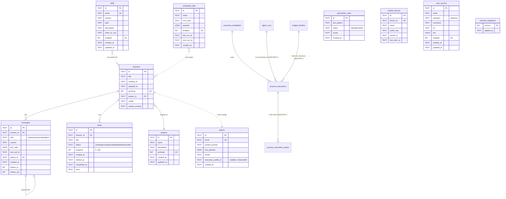

# Storage Schema

> **Owner:** `storage-layer` task. **Status:** Phase 1 (T0). **Source of truth:** `agent/minimax_code/storage/`.
> This document is the contract between the storage layer and the rest of the agent. If you change a column, an index, or a constraint, update this doc and add a migration.

The Python sidecar persists structured agent state in a single SQLite database file;
registered text artifact originals live in the separate managed vault described in Schema041.
Uploaded attachment originals use a second managed vault described in Schema042.
Schema046 Office delivery receipts reference that same attachment vault; there is no third vault.
The database file lives at:

| OS      | Path                                                                |
|---------|---------------------------------------------------------------------|
| Windows | `%APPDATA%\MiniMaxCode\data.db` (i.e. `C:\Users\<u>\AppData\Roaming\MiniMaxCode\data.db`) |
| macOS   | `~/Library/Application Support/MiniMaxCode/data.db`                |
| Linux   | `${XDG_DATA_HOME:-~/.local/share}/MiniMaxCode/data.db`              |

Resolution is delegated to the [`platformdirs`](https://pypi.org/project/platformdirs/) library. Tests use a fresh path under `tempfile.gettempdir()`.

## 1. ER diagram

The dashed edges in the diagram (`agents → sessions`, `skills → sessions`, `scheduled_jobs → sessions`) are *application-level* relationships — the row IDs they reference may be embedded as JSON inside a payload, or are resolved at lookup time. They are **not** foreign keys because the agent occasionally needs to refer to a deleted record (e.g. an audit log of "which agent ran on this session").

## 2. Table-by-table

### 2.1 `sessions`

| Column          | Type    | Notes                                                  |
|-----------------|---------|--------------------------------------------------------|
| `id`            | TEXT PK | Prefix `ses_` plus a 10-char uuid4 hex.                |
| `title`         | TEXT    | User-supplied; default `''`. LIKE-search uses `COLLATE NOCASE`. |
| `created_at`    | TEXT    | ISO-8601 UTC, second precision.                        |
| `updated_at`    | TEXT    | Bumped on every mutation. The sidebar sorts by this.   |
| `archived`      | INTEGER | `0`/`1`. CHECK-constrained; `archived=1` is "tucked away". |
| `project_id`    | TEXT FK | → `projects.id` **ON DELETE SET NULL**; defaults to `inbox`. The sidebar groups sessions by project. |
| `model`         | TEXT    | Nullable; e.g. `gpt-4o`, `claude-sonnet-4-20250514`.   |
| `system_prompt` | TEXT    | Nullable; only set when the user pins one to a session.|

### 2.2 `projects`

| Column        | Type    | Notes                                                  |
|---------------|---------|--------------------------------------------------------|
| `id`          | TEXT PK | Natural key; `inbox` is the immutable default project. |
| `name`        | TEXT    | Display name (e.g. "收件箱").                          |
| `description` | TEXT    | Optional free text.                                    |
| `archived`    | INTEGER | `0`/`1`; archived projects are collapsed in the sidebar. |
| `created_at`  | TEXT    | ISO-8601 UTC.                                          |
| `updated_at`  | TEXT    | Bumped on every mutation.                              |

### 2.3 `messages`

| Column         | Type    | Notes                                                                  |
|----------------|---------|------------------------------------------------------------------------|
| `id`           | TEXT PK | `msg_` prefix.                                                         |
| `session_id`   | TEXT FK | → `sessions.id` **ON DELETE CASCADE**.                                |
| `role`         | TEXT    | CHECK in `('system','user','assistant','tool')`.                       |
| `content`      | TEXT    | Body. May be empty for assistant tool-call turns.                      |
| `tool_calls`   | JSON    | OpenAI-style array; nullable. Stored as a JSON text column.            |
| `tool_call_id` | TEXT    | Set on `role='tool'` rows to point at the originating assistant call.  |
| `parent_id`    | TEXT FK | → `messages.id` **ON DELETE SET NULL**; supports branching chat trees. |
| `created_at`   | TEXT    |                                                                        |
| `tokens_in`    | INTEGER | Accumulated for cost / budget UI.                                      |
| `tokens_out`   | INTEGER |                                                                        |

### 2.3 `tasks`

| Column         | Type    | Notes                                                       |
|----------------|---------|-------------------------------------------------------------|
| `id`           | TEXT PK | `task_` prefix.                                             |
| `session_id`   | TEXT FK | → `sessions.id` **ON DELETE CASCADE**.                     |
| `title`        | TEXT    | Human label.                                                |
| `status`       | TEXT    | CHECK in `('pending','running','completed','failed','cancelled')`. |
| `progress`     | INTEGER | CHECK `BETWEEN 0 AND 100`.                                   |
| `created_at`   | TEXT    |                                                             |
| `started_at`   | TEXT    | Auto-filled on the first `status='running'` transition.     |
| `completed_at` | TEXT    | Auto-filled on any terminal status (`completed`/`failed`/`cancelled`). |
| `error`        | TEXT    | Populated when `status='failed'`.                           |

### 2.4 `skills`

| Column         | Type    | Notes                                              |
|----------------|---------|----------------------------------------------------|
| `id`           | TEXT PK |                                                    |
| `name`         | TEXT    | **UNIQUE** — natural key. The DAO `upsert` matches on this. |
| `version`      | TEXT    | Semver-ish (`'0.0.0'`).                            |
| `path`         | TEXT    | Absolute path to the `SKILL.md` directory.         |
| `description`  | TEXT    | Free text.                                         |
| `when_to_use`  | TEXT    | Free text; injected into the LLM context.          |
| `enabled`      | INTEGER | `0`/`1`; toggled from the sidebar.                 |
| `created_at`   | TEXT    |                                                    |
| `updated_at`   | TEXT    | Bumped on every mutation.                          |

### 2.5 `scheduled_jobs`

| Column        | Type    | Notes                                                       |
|---------------|---------|-------------------------------------------------------------|
| `id`          | TEXT PK |                                                             |
| `name`        | TEXT    | Display name; not unique — multiple jobs may share a name.  |
| `cron_expr`   | TEXT    | Standard 5-field cron. Parsed by APScheduler at run time.   |
| `payload`     | JSON    | Free-form; the agent interprets it on fire.                 |
| `enabled`     | INTEGER | `0`/`1`.                                                    |
| `last_run_at` | TEXT    | ISO-8601 of the last *successful* fire.                     |
| `next_run_at` | TEXT    | Computed by the scheduler tick; the "due" query uses this.  |
| `created_at`  | TEXT    |                                                             |

### 2.6 `agents`

| Column           | Type    | Notes                                                |
|------------------|---------|------------------------------------------------------|
| `id`             | TEXT PK |                                                      |
| `name`           | TEXT    | **UNIQUE** — natural key for sub-agent lookup.       |
| `system_prompt`  | TEXT    | Default `''`.                                        |
| `tool_allowlist` | JSON    | Array of tool names the sub-agent may call. `NULL` means "all". |
| `model`          | TEXT    | Override the global model. Nullable.                 |
| `execution_profile_id` | TEXT | Schema040, default NULL. Public roots default to native-host; trusted children inherit their parent's frozen target. Unknown IDs remain saved but cannot execute without catalog availability. |
| `created_at`     | TEXT    |                                                      |

### 2.7 `permission_rules`

| Column         | Type    | Notes                                                                                 |
|----------------|---------|---------------------------------------------------------------------------------------|
| `id`           | TEXT PK |                                                                                       |
| `tool_pattern` | TEXT    | Glob-ish matcher (e.g. `file_ops:*`, `terminal:bash`). Lookup is `LIKE 'pattern%'` for the prefix index. |
| `action`       | TEXT    | CHECK in `('allow','deny','ask')`.                                                    |
| `scope`        | TEXT    | Default `'global'`. Future: `'session:<id>'`, `'project:<path>'`.                    |
| `created_at`   | TEXT    |                                                                                       |

Rules are evaluated in insertion order; the first match wins. The auth layer caches a `(pattern → action)` map in memory; reload after every write.

### 2.8 `mobile_devices`

| Column         | Type    | Notes                                  |
|----------------|---------|----------------------------------------|
| `id`           | TEXT PK |                                        |
| `device_id`    | TEXT    | **UNIQUE** — natural key (the QR-paired ID). |
| `name`         | TEXT    | User-set friendly name.                |
| `public_key`   | TEXT    | Hex/base64. Used to verify push signatures. |
| `paired_at`    | TEXT    |                                        |
| `last_seen_at` | TEXT    | Bumped by the IPC `mobile.touch` handler. |

### 2.9 `mcp_servers`

| Column        | Type    | Notes                                                  |
|---------------|---------|--------------------------------------------------------|
| `id`          | TEXT PK | UUID v4.                                               |
| `name`        | TEXT    | Display name; user-defined.                            |
| `transport`   | TEXT    | CHECK in `('stdio','sse','streamable_http')`.                            |
| `command`     | TEXT    | Shell command line for `stdio` transports; nullable.   |
| `url`         | TEXT    | Endpoint URL for HTTP/SSE transports; nullable.           |
| `env`         | JSON    | Key/value environment variables; empty object default. |
| `enabled`     | INTEGER | `0`/`1`; disabled servers are not started at boot.     |
| `created_at`  | TEXT    | ISO-8601 UTC.                                          |
| `updated_at`  | TEXT    | Bumped on every mutation.                              |
| `bearer_token` | TEXT | Nullable local bearer token (Schema024). |
| `headers` | JSON | Nullable extra HTTP headers. |
| `oauth_client_id` / `oauth_client_secret` | TEXT | Nullable OAuth config; no token flow is implied. |
| `oauth_scopes` | JSON | Nullable requested scopes. |
| `oauth_callback_port` | INTEGER | Nullable callback port. |
| `tool_states` | JSON | Nullable per-tool enablement map. |

### 2.10 `schema_migrations`

| Column       | Type    | Notes                                       |
|--------------|---------|---------------------------------------------|
| `version`    | INTEGER | PK; matches the `NNN_` prefix of the migration filename. |
| `applied_at` | TEXT    | ISO-8601 UTC.                               |

### 2.11 `codebase_chunks`

| Column         | Type    | Notes                                                                  |
|----------------|---------|------------------------------------------------------------------------|
| `id`           | TEXT PK | UUID v4.                                                               |
| `file_path`    | TEXT    | Path relative to the indexed workspace root.                           |
| `start_line`   | INTEGER | First line of the chunk (1-indexed).                                   |
| `end_line`     | INTEGER | Last line of the chunk.                                                |
| `content`      | TEXT    | Full chunk text used for FTS search and snippet generation.            |
| `metadata`     | JSON    | Language, total line count, extracted symbols, etc.                    |
| `created_at`   | TEXT    | ISO-8601 UTC.                                                          |
| `updated_at`   | TEXT    | Bumped on every re-index.                                              |

The companion FTS5 virtual table `codebase_chunks_fts(file_path, content)` provides keyword search; triggers keep it synchronized with the main table.

## 3. Index strategy

| Index                            | Table              | Purpose                                                                                  |
|----------------------------------|--------------------|------------------------------------------------------------------------------------------|
| `idx_sessions_archived_updated`  | `sessions`         | Sidebar: "active sessions, most recent first". The composite is more selective than `updated_at` alone. |
| `idx_sessions_project_updated`   | `sessions`         | Project-scoped session listing: sessions within a project, most recent first.            |
| `idx_sessions_updated`           | `sessions`         | Fallback for "all sessions, most recent first" (admin view).                             |
| `idx_projects_archived_updated`  | `projects`         | Sidebar project list: active projects first, then archived, sorted by recency.           |
| `idx_messages_session_created`   | `messages`         | Listing messages for a session in chronological order — the dominant read pattern.      |
| `idx_messages_parent`            | `messages`         | Branching chat: walk the tree from a node.                                               |
| `idx_messages_tool_call_id`      | `messages`         | Resolve a tool result back to its originating call.                                      |
| `idx_tasks_session_created`      | `tasks`            | List tasks for a session.                                                                |
| `idx_tasks_status`               | `tasks`            | Dashboard widgets: "how many failed?"                                                     |
| `idx_skills_enabled`             | `skills`           | "Which skills should the agent inject into the system prompt?"                           |
| `idx_skills_name`                | `skills`           | Defensive — `name` is `UNIQUE` so SQLite auto-indexes; this is an explicit alias for clarity. |
| `idx_jobs_enabled_next_run`      | `scheduled_jobs`   | The scheduler tick: "enabled jobs whose `next_run_at` is in the past."                    |
| `idx_jobs_name`                  | `scheduled_jobs`   | Lookup by friendly name.                                                                 |
| `idx_agents_name`                | `agents`           | Same as skills — explicit alias of the UNIQUE auto-index.                                |
| `idx_permissions_tool_pattern`   | `permission_rules` | Lookup rules by pattern prefix (the auth matcher's hot path).                            |
| `idx_permissions_action`         | `permission_rules` | "List all my allow rules" (UI).                                                          |
| `idx_devices_device_id`          | `mobile_devices`   | Explicit alias of the UNIQUE auto-index.                                                 |
| `idx_devices_last_seen`          | `mobile_devices`   | "Recently seen" widget.                                                                  |
| `idx_mcp_servers_enabled_updated`| `mcp_servers`      | Settings list: enabled servers first, sorted by recency.                               |
| `idx_codebase_chunks_file_path`  | `codebase_chunks`  | Retrieve all chunks for a file (summarize / invalidate).                              |
| `idx_codebase_chunks_updated_at` | `codebase_chunks`  | Recently indexed files / directory summaries.                                          |
| `codebase_chunks_fts`            | `codebase_chunks`  | FTS5 virtual table for keyword search over `file_path` + `content`.                    |

Two of these tests assert the planner actually picks the index (`test_messages_index_used_for_session_listing`, `test_sessions_index_used_for_listing`). They run `ANALYZE` first so the planner has statistics.

## 4. Migration strategy

* Migrations are versioned `NNN_short_name.py` modules in `minimax_code/storage/migrations/`.
* Each module exports a `VERSION: int` (must match the filename prefix) and a `run(conn)` callable that takes either a `sqlite3.Connection` or `aiosqlite.Connection` and applies DDL.
* The `schema_migrations` table is the bookkeeping. It's created on demand by `ensure_migration_table` before the discovery scan.
* On every `Database.migrate()` / `AsyncDatabase.migrate()`:
  1. Read applied versions.
  2. Discover pending modules via `pkgutil.iter_modules` (no manual list).
  3. For each pending version, in ascending order, run inside a `BEGIN IMMEDIATE` transaction; on success, insert `(version, applied_at)`.
* Migrations are **forward-only**. There is no down-migration — if you need to undo, write a new forward migration. SQLite's `ALTER TABLE RENAME COLUMN` (3.25+) is preferred over copy-and-rename.
* `aiosqlite`'s connection proxies every method through a worker thread, so calling a sync migration against it is awkward. The async wrapper therefore opens a short-lived sync `Database` to apply migrations — `WAL` mode makes the schema visible to the async connection immediately after `COMMIT`.

## 5. Connection configuration

Every connection we open applies this pragma set:

| Pragma              | Value     | Why                                                                |
|---------------------|-----------|--------------------------------------------------------------------|
| `journal_mode`      | `WAL`     | Concurrent readers + single writer; the agent's main use case.     |
| `foreign_keys`      | `ON`      | Off by default in SQLite. We rely on `ON DELETE CASCADE`.          |
| `synchronous`       | `NORMAL`  | WAL-friendly: durability on commit, no per-statement fsync.        |
| `busy_timeout`      | `5000`    | 5 s before SQLite gives up on a contended lock.                    |
| `temp_store`        | `MEMORY`  | Keep temp tables in RAM; we never have very large ones.            |

The sync wrapper holds a `threading.RLock` around every public method. This serializes writers (which is what SQLite wants anyway) and lets the same `Database` instance be shared across threads.

The async wrapper holds an `asyncio.Lock` and runs every query through `aiosqlite`'s single connection. Multiple concurrent tasks will queue, but the agent's queries are small and fast.

## 6. Known limitations

* **Single-process only.** A second agent process pointing at the same file will see WAL contention, not data loss, but should not be relied on.
* **No connection pool.** A single connection per process is intentional. The agent is async-first; sync code goes through `Database` and pays for serialization.
* **No row-level encryption.** The DB file is plaintext SQLite. Sensitive fields (e.g. the mobile device public key) are at rest in cleartext. Use OS-level full-disk encryption if you need more.
* **No write-ahead journaling of the schema.** A migration that fails partway through is rolled back as a single transaction, but a manual edit to the DB file is not protected. Operate on a backup when experimenting.
* **Message indexes are not partial.** A partial index on `messages WHERE parent_id IS NOT NULL` would be smaller if branching chat ever becomes the dominant write path; for now the regular index is fine. Run request keys use a partial unique index from schema 031.
* **`tool_calls` JSON is opaque to SQLite.** You can't query "all assistant turns that called `terminal`" without a JSON1 extension. Phase 2 may add generated columns or a separate `message_tool_calls` table.
* **No foreign-key index for `messages.parent_id`.** SQLite doesn't auto-index FKs. The `idx_messages_parent` index covers the `ON DELETE SET NULL` cascade and tree traversal.
* **`name` columns are not normalized.** `SkillsDAO.upsert` matches by exact `name`; if a user renames a skill directory on disk, the old row remains orphaned. Phase 2 will add a "scan & reconcile" pass.
* **Sync `Database` and async `AsyncDatabase` may briefly interleave migrations.** Both wrappers open their own short-lived sync connection during migration. The first to run wins; the second sees an empty pending set. This is intentional but means you should not run two `migrate()` calls in parallel.
* **No schema diff / migration generator.** Migrations are hand-written. Tools like `alembic` or `sqlx` would be a Phase 3 polish item.
* **`platformdirs` is hard-coded to `appname='MiniMaxCode'`, `appauthor=False`, `roaming=True`.** If you change the product name, update both `db.py` and the test that asserts the path.

## 7. Schema 030: durable run events

`run_events` adds `id TEXT PRIMARY KEY`, `run_id` referencing `agent_runs` with
`ON DELETE CASCADE`, positive integer `seq`, `type`, UTC `created_at`, and JSON
`data`. A unique `(run_id, seq)` index supports ordered cursor reads. The migration
adds a table without rebuilding runs or steps; prior actions are not backfilled
as invented events. Existing snapshots therefore start at cursor 0 until changed.

`AgentRunsDAO` writes each new run, status or step together with its event in one
transaction. Concurrent step ordinals and event sequences are allocated under the
database write lock. Recovery closes unfinished steps and appends its review marker
in that same transaction. `run.steps` reads a consistent snapshot and cursor;
`run.events` reads bounded pages. Raw SQL maintenance is outside this journal.

JSON export/import includes the new table. Importing legacy run/step tables without
an event table clears the previous event history in the import transaction, so
stale events cannot describe replacement rows. Clients must reload snapshots after
imports. To roll back an application upgrade, restore the corresponding pre-upgrade
database backup; reverse migrations are not supplied. Retention limits and complete
RunService recovery are still pending.

## 8. Schema 031: durable native requests

`agent_runs` adds nullable `request_key`, `request_hash`, JSON `request`, JSON
`result`, and `resumed_from_id` (self-reference, `ON DELETE SET NULL`). A partial
unique index on `(session_id, request_key)` applies only to non-null keys. The hash
is SHA-256 of canonical JSON user input; mutable global model/workspace selection
does not change the identity of an already accepted request. Request and result
bodies are excluded from timeline rows/events; `run.get` returns the receipt.

The status constraint additionally accepts `queued`, `waiting_input`,
`budget_paused` and `interrupted`. Only queued/interrupted have execution owners in
this change. Admission inserts a queued record and event atomically. Claiming is a
single queued-to-running compare-and-set. Terminal receipt, status and status event
commit together. Startup marks unfinished requests interrupted and closes unfinished
steps with a review marker; it never reruns an uncertain write. Recovery creates a
new request linked to the original run after explicit review.

SQLite table rebuilding requires foreign keys disabled **before** the migration
transaction. Migrations 021, 028 and 031 opt into this runner behavior; foreign-key
integrity is checked before commit and the prior enforcement setting is restored
even after rollback. Schema 031 preserves child rows and attached indexes/triggers.
No historical request bodies or completed receipts are invented for legacy runs.

Back up the database before upgrading. Rollback requires restoring the matching
pre-upgrade database with the prior application version; there is no reverse
migration. The migration itself is transactional, including failure after rebuilding.

Native messages use their streaming assistant ID when persisted and carry
`metadata.run_id`. `MessagesDAO.create(run_id=...)` validates session ownership and
rejects terminated runs. In the message-insert transaction it sets the first user
message pointer or latest assistant pointer and appends the corresponding run event.
An event failure rolls back both the message and pointer. This uses existing columns
and JSON metadata; there is no additional migration or invented linkage for old rows.

## 9. Schema 034: pinned engine continuity

Sessions add `engine TEXT NOT NULL DEFAULT 'native'` constrained to `native|codex`,
nullable `engine_thread_id`, and JSON `engine_state` (version 1). The state saves workspace,
protocol, effective Codex settings, external turn IDs, input/output/total usage watermarks and
uncertainty. Ordinary old sessions stay Native. Legacy Codex history is migrated only when
one thread and verifiable context cover the entire history; mixed, multiple or incomplete
contexts carry `handoff_required` and cannot silently continue.

Codex binding/run snapshot commits before an external turn starts. Serial event processing
updates watermark, assistant token columns, metadata and run event in one transaction.
Messages carry engine/run/turn/status/partial/usage-certainty metadata. Existing NOT NULL token
columns use an internal zero sentinel for missing Codex usage; both message and session history
hydration expose null, and aggregate totals report incomplete usage. Zero is never presented
as known consumption. Unknown intervals survive completion until later attribution; counter
resets retain the old watermark and mark uncertainty. This is not a complete shared daily ledger.

## 10. Schema 035: task outcomes and verification

The tasks table adds nullable `run_id REFERENCES agent_runs(id) ON DELETE SET NULL`
and accepts `budget_paused`, `interrupted`, and `requires_review` alongside prior statuses.
The migration runner rebuilds the populated table with foreign keys disabled before BEGIN,
preserves prior rows, custom indexes/triggers, checks references before commit and restores enforcement.
Session deletion still cascades tasks. Back up before upgrading; downgrade requires restoring the matching database.

Linked task reads project authoritative run execution status, result and verification, including after restart;
status filters/counts use the same projection. Versioned verification is JSON in existing run/message metadata,
not a replacement for execution status. Final evidence updates and assistant status/partial metadata are
transactional with the run event. Preliminary answer receipts persist before asynchronous local validation,
so cancellation or final-settle failure retains known text and records unknown/review evidence.
Legacy task/message evidence remains unknown rather than inventing a pass.

## 11. See also

* `agent/minimax_code/storage/db.py` — connection wrappers
* `agent/minimax_code/storage/migrations/001_initial.py` — the initial schema
* `agent/minimax_code/storage/dao/` — typed DAO classes
* `agent/tests/test_storage.py` — 27 unit tests
* `docs/architecture.md` §5 — system architecture (Storage sits under the agent)

### Schema036：固定调度与发生记录

scheduled_jobs 追加 revision/context_version/context/timezone/binding_state/binding_reason/deleted_at/active_occurrence_id。
迁移将所有旧任务停用并标为 needs_rebind，保留原 payload。schedule_occurrences 保存不可变 prompt/context/job revision、cron UTC 时点或 manual_key、coalesced_through、fingerprint、独立 session/task/run 关联与终态原因。
唯一索引分别约束 cron(job_id,revision,scheduled_for) 与 manual(job_id,manual_key)；任务行 active_occurrence_id 在同一事务中提供跨修订租约。
发生创建与隔离 session/task 同事务；Native 接单同时保存 run、用户消息、occurrence.run_id 与 task.run_id。终态投影以精确当前 run_id 作 CAS，旧恢复来源不能覆盖已接单子运行。
任务软删除以保留幂等键和历史；不自动删除发生证据。升级前备份数据库，回退需旧应用及匹配的升级前数据库备份，不提供或宣称已验证逆向迁移。

### Schema037：共享预算家族、尝试及日账

budget_families 保存不可重置的累计上限、旧历史下界与明确授权；budget_attempts 保存每次实际发送的不可变身份、模型/提供方/目的/价格快照、Asia/Shanghai 预留日、估算、nullable 用量、责任及状态。budget_days 记录升级时历史覆盖缺口与核定依据，budget_coverage 记录覆盖起点。

家族和全机日额度在同一写事务检查与预留，结算和 budget RunEvent 在同一事务落盘；Codex 同线程水位也加入该事务。外键和日/家族索引保留结束后的未知责任。Schema037 临时禁止预算及运行依赖的 JSON 替换式恢复，允许无关部分导入；完整灾难恢复兼容性列为 M7 必做后续项。备份/回退与语义详见 [共享预算账本](budget-ledger.md)。

### Schema038：公开 Agent 根接单映射

agent_root_admissions 以 (source_session_id, request_key) 为唯一键，保存规范意图摘要、独立 execution_session_id、run_id 和创建时间。两个关联均有外键及唯一约束。该映射与 execution session、queued run、预算家族和初始事件同事务创建；它不另设执行状态机。准备身份、冻结执行配置和 pending/ready 证据保存在运行的 agent_execution metadata，状态仍由 RunService 管理。

重放先读此映射，不创建第二副本或读取已删除的实时配置。启动恢复只把旧活动运行及保存回执投影为 interrupted，保留未知预算责任；不自动重建 pending 副本或重放未知写。038 映射也受运行历史 JSON 替换导入保护。升级前使用 SQLite 在线备份；回退须停止服务并恢复匹配旧程序的完整备份，保留升级后的数据库及工作副本供核对，不删除映射来重复执行。

### Schema039：持久进程所有权基础（L1 尚未验收）

039 新建三张表，不重建既有业务表；这项迁移不表示容器 profile 已可用。

| 表 | 字段与约束 |
|---|---|
| `execution_installation` | `singleton=1` 主键；唯一 `install_id`；UID、host/store/location fingerprint、bootstrap nonce、canonical dataDir 与 dev/ino、marker hash；`phase` 仅 bootstrap_pending/active；创建及激活时间。 |
| `process_executions` | `exec_id` 主键；run、budget family、family root、installation 均为显式 ON DELETE RESTRICT 外键；唯一 container name 和 nullable 唯一完整 CID；state/revision、target JSON/hash、workspace/identity、argv hash、container cwd、deadline、资源保留、outcome/exit/OOM/error、时间。 |
| `process_execution_events` | `(exec_id, ordinal)` 复合主键；exec_id RESTRICT 外键；前后 state、最小 evidence JSON 与创建时间。 |

所有目录 device/inode 字段使用精确十进制 TEXT，包含超过有符号 int64 的 Windows
identity；DAO 不转 float。installation store 指纹绑定持久 graphRoot 路径/dev/ino、driver、
UID 与 host；location 指纹只绑定 host/UID/canonical graphRoot/dataDir，允许诊断同路径
恢复后的旧容器。临时 runRoot inode 不作为持久所有权。

`process_executions.state` 为 intent/created/starting/running/stopped/removing/removed/
cleanup_pending/needs_review。每次 revision CAS 与 event 在同一事务提交。intent 同事务
核对实际 run/family/root 与唯一 admitted snapshot，检查安装/家族资源并保留额度；
`resource_held=1` 的未知结果继续占用。只有精确持久 name/CID 已证实 absent 的 removed 状态才释放。
索引 `idx_process_executions_active(install_id,resource_held)` 和
`idx_process_executions_family(family_id,resource_held)` 支持这些核对。

新 policy2 intent 一次固定 `deadline_boot_id` 与正 int64 `deadline_boottime_ns`，使用
CLOCK_BOOTTIME 绝对期限；旧 `deadline` REAL 为 Unix 审计展示值。两个新字段允许 NULL
仅为历史责任清理兼容：缺字段、boot 改变、旧 policy1 不得 create/start，也不补写新期限。
容器 created 状态常有 ExitCode 0；它不是成功。终结结果必须核对 exited、Running=false、
Pid=0 和有效非零 StartedAt/FinishedAt；raw 124/125 仍有 guard/payload 歧义。

运行 metadata 是唯一授权源：公共根使用 `agent_execution` v3，可信内部孩子使用
`process_execution_owner` v1；同时出现拒绝。私有固定零模型 runtime preflight 使用 v2
owner variant，必须由同一 RunService 私有路径生成自己的真实 run/family，普通元数据
不能授予该能力。复制准备状态与 source/owned 身份也保存在这个 snapshot。

L1 初始化在服务租约内、后台任务之前将该 AsyncDatabase connection 切换为
`synchronous=FULL` 并读回；每次 intent 再确认。DB 先落 pending 身份，随后独占发布并
fsync 私有 marker，最后 CAS active。active 缺 marker、DB 丢失而 marker 尚存、换主机/
UID/store/dataDir、同安装 orphan 或 inventory 未知均不能自动认领或按标签清理。

`data.export` 和 SQLite online backup 包含全部三表；`data.import` 拒绝替换这三表，
即使输入仅含空表也在写入前拒绝。037 的预算/run 历史导入保护继续生效。JSON export
不包含 marker，不能当作安装恢复手段。完整恢复须离线保留匹配 DB、marker、服务目录
物理身份和 Podman store，并在相同租约下核对全部持久责任；复制 DB 不取得删除权限。

### Schema040：nullable Agent execution profile 与升级/回退

040 仅追加 `agents.execution_profile_id TEXT DEFAULT NULL`，旧行自然保持 NULL，
因此默认 host 兼容。CRUD update 缺失字段保留原值，显式 null 恢复默认。profile 参数
保存在服务私有 catalog，不把 image/resource/env 放到 Agent 可写 JSON 参数中。

升级前使用 SQLite online backup，保存应用版本、DB 与私有 marker（若已有）及安装
身份信息；自动迁移仍为向前迁移。当前 profile unavailable，不因升级启动用户容器。
回退前停止接单，保留 RunService/supervisor/DB/租约直到清理已核实；清理未知时不能
删表、删 marker、改 run 状态或释放资源来凑回退。保存升级后 DB、marker、owned copies
及完整 CID 证据，再恢复匹配旧程序的完整升级前备份。没有 039/040 down-migration，
也不承诺旧二进制直接打开升级后 DB 或跨安装恢复。L1 整体及灾难恢复仍须独立验收。

### Schema041：显式文本成果与私有 vault

新增 `artifact_service(singleton=1, service_id)` 保存服务生成的持久 vault 身份；新增
`text_artifacts` 保存不可变登记元数据：id、project_id、可空 run_id、service_id、
source_path、唯一 snapshot_id、mime_type、size_bytes（0–2097152）、sha256、正整数
version、parse_status、verification_status、created_at。
`UNIQUE(project_id, source_path, version)` 在同一 SQLite IMMEDIATE 事务中递增版本，
并复核 live project root 与 run/session 项目归属；同字节重复登记也增加版本。
当前 parse_status 仅 `parseable`，verification_status 仅 `unverified`，没有质量通过/
已交付状态。三种 MIME 只描述 TXT/MD/CSV，文件内容始终保存原始 UTF-8 字节。

项目/run ID 是历史引用，有意不设置会级联删除历史的 FK；项目删除保留行及磁盘证据，
正常 API 仍要求项目存在。没有自动 filesystem cascade。完整、fsync 后的文件以
非覆盖原子发布到服务 dataDir 下 `text-artifact-vault/<snapshot_id>` 后才插入元数据；
POSIX vault 0700/文件 0600，Windows 受服务账户目录 ACL 与锁定句柄保护。不得据此
宣称能隔离已被攻陷的同一 OS 账户。DB 失败或进程在发布与提交间退出可能保留 orphan，
不将其视为登记成功，也不扫描删除任意历史文件。

读取只使用受约束的 snapshot ID，核对 vault 原字节长度和 SHA-256，缺失或损坏失败，
不回退读取 source。源文件不修改；替换 source 后历史版本仍从 vault 下载。备份/恢复
必须一起保全 SQLite 与匹配 `text-artifact-vault`。`data.export` 的 JSON 仅含本片元数据，
SQLite online backup 也不含这些外部字节；恢复数据库而没有 vault 原字节时下载返回
missing/corrupt，不回读 source。M7 再集成完整备份包，本片不扩大现有备份实现。
迁移仅向前，回退应恢复匹配旧程序的完整 DB/文件备份，不删除 vault 猜测
回收。本片只支持显式 TXT/MD/CSV 登记；RPC/下载契约见 ipc-contract.md 的 artifact 节。

### Schema042：项目附件原件与有界文本预览

新增普通表 `attachments`：id 主键、project_id、service_id、唯一 snapshot_id、original_name、
declared_type、recognized_type、size_bytes（0–10485760）、sha256、version、parser_status、
parser_version（当前 1）、preview_text、preview_truncated（0/1）、quality_status（仅 unverified）、created_at。
`UNIQUE(project_id,original_name,version)` 在 IMMEDIATE 事务分配版本，同时复核项目 id/root_path/created_at
与共享 artifact_service 身份。项目无需设置根目录；文件名仅是显示元数据，不能指定主机路径。
项目删除不级联销毁历史行/原件，API 仍要求项目存在。

原始字节单独位于 `attachment-vault/<snapshot_id>`，与 text-artifact-vault 分开。
流接收有 10 MiB/120 秒硬限；只在完整、fsync 和无覆盖发布后提交可用行。
中断/超限精确清理自有 pending；发布与 DB 提交之间故障可能留下完整 orphan，不能凭扫描补造记录。
读取固定句柄检查普通文件、链接/重解析点、所有者、大小、两次 SHA256 和文件身份，损坏不回读外部源。
POSIX 文件/目录为 0600/0700，并 fsync 发布目录；Windows 文件刷新+无覆盖发布，未承诺断电目录持久性。

TXT/CSV 完整检查严格 UTF-8/NUL/CSV 语法，预览最多 64 KiB/2000 行；失败保留原件并显式 parse_failed。
PDF/Office 标记 parser_unavailable，图片 ocr_not_attempted；类型异常 type_mismatch。
原件保存不证明可解析、质量通过或交付。Office 不解压/执行，CSV 不计算公式。
`data.export` 自动包含该表元数据和有界预览，但 JSON/SQLite-only 备份不包含独立原件。
离线 bundle v2 固定支持 Schema042，DB 与两个 vault 必须共同保全；没有 042 down-migration。
升级前停服务并用旧 v1 工具保存 Schema041 DB+文本 vault；升级后用 v2 保存完整数据。
回退应恢复与旧程序匹配的升级前备份，不能把旧程序直接指向042，不能删表/vault伪造回退。

### Schema043：版本化 DOCX 正文解析元数据

重建 attachments，保留042全部旧字段和值，parser_version允许1/2；新增parser_reason、parser_scope。
历史v1两字段固定legacy_v1，不自动重解析；新上传算法为2，scope为inert_text、
docx_body_paragraphs_tables或original_only。所有记录quality_status仍为unverified。
稳定原因和子进程边界见[DOCX有界解析](attachment-docx.md)。DOCX解析失败/依赖缺失/超限仍保存原件。
043只由bundle v3新建；v1/041、v2/042仍可原样验证/恢复，不迁移或重新绑定。旧工具拒绝v3，
没有043降级迁移；回退必须恢复匹配旧程序的升级前备份。

### Schema044：历史流式用量可信度

数据迁移，不新增表或计数字段。对升级前 provider 结算记录，使用持久 owner/root 的
provider+model 路由快照判定：可确认 OpenAI 或匹配的 Codex 外部轮次保持原状；
Anthropic 及无法确认协议者由 settled 改为 unknown，追加原因和 budget 审计事件。
原数字、估算、usage、provenance、时间、coverage、回执及验证结论保留；不把旧记录
全部认定为错误，也不推算缺失 token 或账单。事件失败使整次迁移和版本记录回滚。

服务须先取得排他租约并停止旧写入者，迁移完成后才开放接单。未知尝试沿用现有家族/
每日预算阻断与显式核对路径：确认、说明、责任额度不低于已记录值且 owner 静止；
核对后可解除责任阻断，但 usage_complete 仍为 false，不伪造完整测量。新日期按原有
日期边界隔离，不能用覆盖起点或删除历史释放责任。

Schema044 引入 v4 数据包；v1/041、v2/042、v3/043 仍只校验/原样恢复，不自动迁移。
当前创建版本见下方 Schema048。
升级前停服务，用对应旧工具保存匹配的 DB+vault；回退恢复旧程序及升级前完整备份，
不直接让旧程序读取044，不做逆向迁移。该数据包仍不包含运营恢复所需的全部配置/所有权。

### Schema045：MCP Streamable HTTP

在迁移事务中重建 `mcp_servers`，仅把 transport CHECK 扩展为
`('stdio','sse','streamable_http')`。保留 stdio/SSE 标识、全部配置与原始 JSON 字符串、
空值、时间、凭据、OAuth 字段和工具开关；不重写 URL、不把历史 SSE 自动转为 HTTP。
沿用主键、name 唯一约束、enabled 检查、默认值及索引/触发器。迁移 runner 在事务前暂时
关闭外键，提交前执行完整 foreign_key_check，失败回滚表、数据及版本记录并恢复外键设置。
重建前先核对 table_xinfo 列和正式017 CREATE + 024 ALTER生成的 sqlite_master 表定义；
额外/隐藏列，以及同名列但 CHECK、默认值、NOT NULL、UNIQUE、collation、外键、
WITHOUT ROWID 或 STRICT 不同的外部表定义均拒绝，不静默抹掉已有约束。
此处使用精确正式 SQL 对比，连语义等价的外部格式改写也会拒绝；自定义索引/触发器作为
独立 schema 对象保留，不被该表定义限制排除。

045对应历史 v5/Schema045；当前创建版本见下方 Schema048。
旧包继续校验/原样恢复 SQLite 字节，恢复不运行迁移。旧版工具拒绝 v5/045；未知格式、
未来 schema 及格式/schema 不匹配均拒绝。回退须恢复对应旧程序和升级前完整 DB+vault 备份，
没有045逆向迁移；数据包仍为 data-only。

### Schema046：已登记的办公成果

046只新建普通表 `office_deliveries` 及其索引，不重建或改写任何旧表。精确12列如下：

| 列 | 持久化合同 |
| --- | --- |
| `id` | TEXT PRIMARY KEY，`off_`加32位小写hex |
| `project_id` | TEXT NOT NULL，历史项目引用 |
| `service_id` | TEXT NOT NULL，`svc_`加32位小写hex，与附件及artifact_service一致 |
| `attachment_id` | TEXT NOT NULL UNIQUE，引用既有附件；字节只存在attachment-vault |
| `run_id` | 可空TEXT，历史run引用，不赋予运行权限 |
| `request_key` | TEXT NOT NULL，与project_id构成UNIQUE幂等身份 |
| `request_hash` | TEXT NOT NULL，规范化请求与目标关联的SHA-256 |
| `input_sha256` | TEXT NOT NULL，规范化表格输入的SHA-256 |
| `writer_version` | TEXT NOT NULL，当前固定`3.1.5` |
| `validator_version` | INTEGER NOT NULL，CHECK固定为1 |
| `validation_report` | TEXT NOT NULL，严格JSON报告，UTF-8至多64KiB |
| `created_at` | TEXT NOT NULL |

索引 `idx_office_deliveries_project(project_id,created_at,id)` 支持稳定列表顺序。
project/run/attachment为保留历史的逻辑引用，不设级联删除；服务访问仍须验证当前项目存在。
只记录已完成登记的成果。来源、格式和检查范围由固定报告合同表达，不增加重复状态列、
pending/run恢复状态或第三个vault。附件与交付记录由服务在同一DB事务提交。

`office_metadata.py`用纯stdlib验证持久行、解码报告并核对附件，不加载办公生成器。
行必须精确包含上述列；ID和hash格式严格，project/run为1–128字符，request_key匹配`[A-Za-z0-9_-]{1,128}`，
writer/validator版本与报告一致。报告严格字段为：`version=1`、
`scope=xlsx_plain_cells_v1`、`input_sha256`、`file_sha256`、`size_bytes`（1–2097152）、
`sheet_name`（1–31字符，拒绝Excel非法字符、控制符、首尾单引号及纯空白）、`data_rows`（0–1000）、`column_count`（1–20）、
`cell_count=(data_rows+1)*column_count`（至多5000）、`formula_count=0`、
`external_relationship_count=0`、`macro_count=0`、`structure_status=passed`、
`business_quality=unverified`、`render_status=not_attempted`、
`writer={name:openpyxl,version:3.1.5}`、`validator_version=1`。
整数不接受bool/float；拒绝未知/缺失字段、JSON重复key、非有限值及未来版本。
报告不含preview字段；预览沿用附件元数据。报告文件hash/大小必须与同project/service的
`declared_type=recognized_type=xlsx`附件一致。报告合同验证不等于重新校验XLSX字节、渲染或业务验收。

历史writer创建 v6/Schema046。精确读取映射为v1/041、v2/042、v3/043、v4/044、
v5/045、v6/046、v7/047、v8/048；旧包保持原schema和全部DB/vault字节，restore不执行迁移、生成或Office解析。
v6至v8清单包含`office_deliveries`，即使没有记录也必须为[]；v1–5不接受该清单字段。
成果引用的附件仍只计一次文件数和字节数。未知格式、未来schema或版本错配均拒绝。
046失败使新表、索引及版本记录一起回滚；无逆向迁移。回退须使用匹配旧程序与升级前
DB+vault备份恢复到新目录，不能删表或手动改写版本号。

### Schema047：远程服务端口

`hosts.remote_port` 为每台主机保存远端 agent 端口，范围 1–65535，旧记录默认 8765。修改端口会断开现有隧道。离线 bundle v7 对应 Schema047；v1–v6 保留验证与原样恢复支持。

### Schema048：Webhook 投递记录

`webhook_deliveries` 保存入站投递的持久化 claim：`webhook_id` 与认证请求体
的 `body_sha256` 构成复合主键；可空的 `delivery_id` 与 `webhook_id` 组合唯一，
ID 是未签名的关联提示。`state` 非空且仅允许 `pending`、`completed`、`review`；
`error_id`、`stage` 可空，`created_at` 和 `updated_at` 非空。完成记录的 `stage`
保存有界事件语义指纹（并不认证事件头）；旧完成记录无指纹时重试需要核对。
记录没有外键或级联删除，
保留历史核对依据。处理中断和部分失败不可自动重试；详见 [IPC 契约](ipc-contract.md)。

当前离线 bundle v8 对应 Schema048；v1–v7 继续支持验证及原样恢复。恢复旧备份会回退
投递账本，无法保护备份之后执行过的投递，重新开放入口前须核对。
